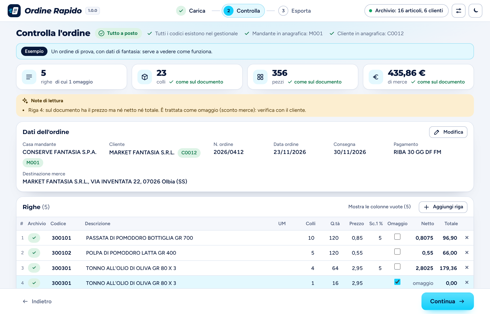
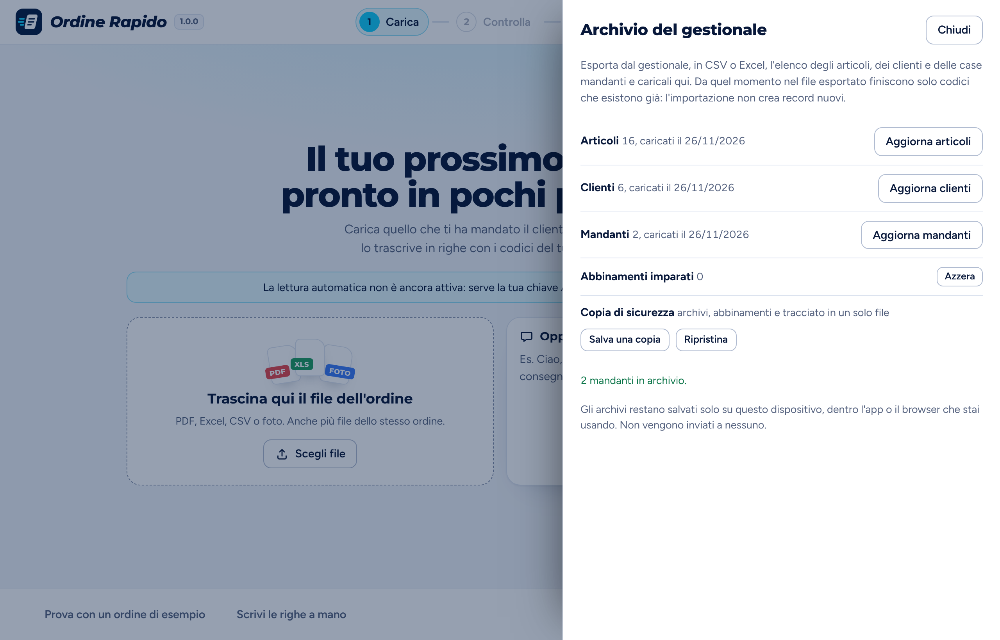

# Ordine Rapido

**Ordine Rapido** trasforma gli ordini che ricevi dai clienti (PDF, Excel, foto o un semplice messaggio) in un file CSV o Excel pronto da importare nel gestionale, fatto come il gestionale lo vuole e usando **solo codici che nel gestionale esistono già**.

È pensato per gli agenti di commercio, è gratuito ed è software libero con licenza GPL-3.0. Funziona da solo sul tuo computer: non ha un server, non ha bisogno di un dominio e **legge gli ordini senza chiave API e senza inviare nulla**. Chi vuole può aggiungere Claude per i documenti più difficili.



Il progetto è nato dentro «AI TUOI ORDINI», un'iniziativa sull'uso dell'intelligenza artificiale nel lavoro quotidiano degli agenti di commercio.

## Indice

- [Che cosa fa](#che-cosa-fa)
- [L'archivio del gestionale](#larchivio-del-gestionale)
- [Lettura degli ordini](#lettura-degli-ordini)
- [Scaricare e avviare](#scaricare-e-avviare)
- [Aggiornare senza perdere gli archivi](#aggiornare-senza-perdere-gli-archivi)
- [Dati e riservatezza](#dati-e-riservatezza)
- [Il file per il gestionale](#il-file-per-il-gestionale)
- [Provare con i dati di esempio](#provare-con-i-dati-di-esempio)
- [Versioni e registro delle modifiche](#versioni-e-registro-delle-modifiche)
- [Per chi sviluppa](#per-chi-sviluppa)
- [Licenza](#licenza)

## Che cosa fa

La prima volta dici all'app come lavorare, in due passaggi: carichi il **modello del gestionale**, cioè un file di esempio nel formato che il gestionale importa, e l'**archivio** di articoli, clienti e mandanti. Da lì in poi il lavoro si svolge in tre schermate.

1. **Carica.** Trascini il file dell'ordine oppure incolli il messaggio del cliente. L'app lo legge e lo trascrive in righe: codice, descrizione, colli, quantità, prezzo, sconti, omaggi.
2. **Controlla.** Ogni riga viene confrontata con l'archivio del tuo gestionale. Vedi subito che cosa è a posto e che cosa va sistemato: righe non trovate, abbinamenti da confermare, totali diversi da quelli scritti sul documento.
3. **Esporta.** Scarichi il file (CSV o Excel), oppure copi le righe, e lo importi nel gestionale.

Altre cose utili:

- Confronta colli, pezzi e importo con i totali scritti sul documento del cliente.
- Riconosce le righe omaggio e le esporta come sconto 100 %, prezzo zero o solo con la colonna Omaggio, a tua scelta.
- Impara gli abbinamenti che confermi: la volta dopo, la stessa descrizione dello stesso cliente viene collegata da sola.
- Il file si adatta al gestionale: carichi un suo file di esempio e l'app ne ricava colonne, ordine, intestazioni, separatore, decimali, formato delle date e codifica. Le colonne che il gestionale vuole sempre uguali, come il tipo di documento, diventano valori fissi. Ogni dettaglio si può ritoccare a mano.
- Se l'ordine indica solo i cartoni e l'archivio dice quanti pezzi stanno in un collo, la quantità in pezzi viene calcolata.
- Tema chiaro e scuro, utilizzabile anche da telefono.

## L'archivio del gestionale

È il cuore dell'app. **Senza archivio l'app trascrive l'ordine, ma non può garantire nulla sui codici.**

Prima di lavorare esporti dal gestionale, in CSV o Excel, tre elenchi e li carichi dal pulsante **Archivio** in alto a destra:

| Archivio | Colonne riconosciute | A cosa serve |
|---|---|---|
| **Articoli** | codice (obbligatorio), descrizione, EAN, unità di misura, casa mandante, prezzo di listino, pezzi per collo | Ogni riga dell'ordine viene collegata a un articolo esistente |
| **Clienti** | codice (obbligatorio), ragione sociale, partita IVA | Nel file finisce il codice cliente del gestionale |
| **Mandanti** | codice (obbligatorio), ragione sociale, partita IVA | Nel file finisce il codice della casa mandante |

L'app riconosce da sola le colonne dalle intestazioni; se sbaglia, le indichi tu prima di salvare. Puoi caricare un file per volta e scegliere se sostituire l'archivio o aggiungere e aggiornare, per esempio un listino per ogni mandante.



### Come nasce la garanzia «nessun record nuovo»

- Una riga è **collegata** quando corrisponde a un solo articolo dell'archivio: per codice articolo (anche con zeri iniziali in più o in meno), per EAN, oppure per un abbinamento che hai già confermato.
- Se lo stesso codice esiste in più mandanti, vale quello della mandante dell'ordine; se resta il dubbio, scegli tu.
- Per le righe non trovate l'app può **proporre** un articolo simile. Una proposta non vale finché non la confermi.
- Nel file esportato finiscono il **codice e la descrizione dell'archivio**, non quelli scritti dal cliente.
- **Finché una riga non è collegata, l'esportazione è bloccata.** Puoi collegarla, eliminarla, oppure togliere il blocco di proposito nelle impostazioni.
- Cliente e mandante vengono riconosciuti per partita IVA o per ragione sociale; se non vengono trovati l'app lo segnala, e nel file il loro codice resta vuoto.

L'app non scrive nel gestionale e non lo interroga: lavora sugli elenchi che esporti tu. Quando aggiungi articoli o clienti nel gestionale, esporta di nuovo l'elenco e aggiorna l'archivio.

### Dove restano gli archivi

Sul tuo dispositivo, dentro l'app o il browser che stai usando. Non vengono inviati a nessuno. Dal pannello Archivio puoi fare una **copia di sicurezza** (archivi, abbinamenti imparati e tracciato in un solo file) e ripristinarla su un altro computer o dopo un aggiornamento.

## Lettura degli ordini

Gli ordini si possono leggere in due modi. Lo scegli in **Impostazioni → Chi legge gli ordini**.

### Su questo dispositivo (senza chiave, senza internet)

È il modo predefinito: non serve una chiave API, non costa nulla e **niente esce dal dispositivo**.

| Che cosa | Come viene letto |
|---|---|
| Excel, CSV | Le celle così come sono: l'app riconosce la riga con i nomi delle colonne e incolonna codici, colli, quantità, prezzi, sconti e importi |
| PDF con testo | Il testo e la sua posizione sulla pagina: è la posizione a dire in quale colonna sta un numero |
| Messaggi e mail | Le righe scritte a parole («6 cartoni di…», «passata 10 ct»), le tabelle scritte a spazi e le correzioni più comuni («anzi fai 12», «togli i…») |
| Foto e scansioni | Prima il riconoscimento dei caratteri (modelli PP-OCRv6, inclusi nell'app), poi le stesse regole |

Non c'è un'intelligenza artificiale che interpreta: sono regole, ancorate al tuo archivio. I codici si riconoscono perché esistono nell'archivio, cliente e casa mandante perché il loro nome o la loro partita IVA è scritta nel documento, e una descrizione senza codice viene confrontata con le descrizioni degli articoli per **proporre** quello giusto, da confermare.

Limiti da conoscere:

- La **scrittura a mano** viene letta male: qualche riga può mancare o avere lettere sbagliate. L'app lo segnala ogni volta che legge una foto.
- Le impaginazioni insolite possono non essere riconosciute: in quel caso l'app lo dice e propone Claude oppure le righe a mano.
- La lettura delle foto è inclusa nelle app per Windows, Linux e Mac e nella cartella `app/`; non è nella versione in un solo file `Ordine-Rapido.html`, che resterebbe troppo pesante. Aggiunge circa 28 MB e si carica solo alla prima foto.
- Su un computer recente una foto richiede pochi secondi, su uno modesto fino a una ventina.

### Con Claude (facoltativo)

Per le scritture a mano e i documenti difficili puoi far leggere a Claude, il modello di Anthropic, con la **tua chiave API**.

1. Crea una chiave nella [Console di Anthropic](https://platform.claude.com/settings/keys).
2. Nell'app apri **Impostazioni**, incolla la chiave e premi **Salva e prova**.
3. Scegli il modello. L'elenco viene letto dal tuo account.

Cose da sapere:

- **Serve internet**, e il documento dell'ordine viene inviato ad Anthropic.
- **Ogni lettura ha un costo**, addebitato da Anthropic all'account della chiave. Dipende dal modello e dalla lunghezza del documento: consulta i [prezzi dei modelli](https://platform.claude.com/docs/en/models/overview).
- La chiave resta sul tuo dispositivo e viene inviata soltanto ad Anthropic. Non entra negli archivi, nelle copie di sicurezza né nel file esportato. Puoi anche scegliere di non farla ricordare. Nell'app desktop è custodita cifrata dal sistema operativo e, una volta salvata, non viene più mostrata: se ne vedono solo gli ultimi caratteri.
- Vengono letti al massimo le prime 6 pagine di un PDF e 12 immagini per ordine.

Chiunque legga, vale la stessa regola: la lettura trascrive, non decide. I codici validi sono solo quelli dell'archivio, e ogni ordine va controllato prima di esportare.

## Scaricare e avviare

Tutti i file si trovano nella pagina [**Releases**](../../releases/latest) della repository.

| Che cosa scaricare | Per chi | Come si avvia |
|---|---|---|
| `Ordine-Rapido.html` | Tutti: Windows, Linux, Mac | Doppio clic: si apre nel browser. Nessuna installazione |
| `Ordine-Rapido-…-windows-installazione.exe` | Windows | Installa l'app nel menu Start |
| `Ordine-Rapido-…-windows-portatile.exe` | Windows | Si avvia senza installare |
| `Ordine-Rapido-…-linux-x86_64.AppImage` | Linux | Si avvia senza installare |
| `Ordine-Rapido-…-mac-arm64.dmg` | Mac con processore Apple (M1 e successivi) | Trascina l'app in Applicazioni |
| `Ordine-Rapido-…-mac-x64.dmg` | Mac con processore Intel | Trascina l'app in Applicazioni |

Il file `SHA256SUMS.txt` contiene le impronte di tutti i file, per verificare che lo scaricamento sia integro.

### La versione portatile

`Ordine-Rapido.html` è l'app intera in un solo file. Salvalo in una cartella tua e aprilo con un browser recente; è stata provata con Chrome e con i browser basati su Chromium, come Edge.

Tieni il file **sempre nella stessa cartella e con lo stesso nome**: alcuni browser legano i dati salvati alla posizione del file.

### Windows

Al primo avvio Windows può mostrare l'avviso «PC protetto da Windows». È normale: l'app è gratuita e non ha la firma digitale a pagamento. Premi **Ulteriori informazioni** e poi **Esegui comunque**.

Se invece Windows dice che l'app è stata **bloccata** e non offre «Esegui comunque», sul tuo computer è attivo **Smart App Control** (succede su molti PC recenti con Windows 11): il sistema non lascia partire i programmi senza firma digitale. In questo caso usa la versione portatile `Ordine-Rapido.html`, che si apre nel browser e fa le stesse cose. Non conviene disattivare Smart App Control per questo: è una protezione del sistema e, su molte versioni di Windows 11, una volta spenta non si può riaccendere senza reinstallare il sistema.

### Mac

Al primo avvio il Mac blocca l'app con un avviso di sicurezza. È normale: Ordine Rapido è gratuito e non ha la firma a pagamento di Apple. L'avviso non indica un problema dell'app.

Per autorizzarla, una volta sola:

1. Prova ad aprire l'app e chiudi l'avviso.
2. Apri **Impostazioni di Sistema** e vai su **Privacy e sicurezza**.
3. Scorri fino alla sezione Sicurezza: trovi il messaggio che Ordine Rapido è stato bloccato.
4. Premi **Apri comunque** e conferma con la password del Mac.

Sulle versioni meno recenti di macOS basta fare clic sull'app con il tasto destro, scegliere **Apri** e confermare. Dal secondo avvio l'app si apre normalmente.

### Linux

Rendi eseguibile il file e avvialo:

```bash
chmod +x Ordine-Rapido-*-linux-x86_64.AppImage
./Ordine-Rapido-*-linux-x86_64.AppImage
```

Su alcune distribuzioni recenti i file AppImage richiedono il pacchetto `libfuse2`.

Scarica i pacchetti soltanto dalla pagina ufficiale dei rilasci di questa repository.

## Aggiornare senza perdere gli archivi

1. Leggi nel [registro delle modifiche](CHANGELOG.md) la voce della nuova versione: dice che cosa cambia e che cosa devi fare.
2. Fai una copia di sicurezza: **Archivio → Salva una copia**.
3. Installa la nuova versione, oppure sostituisci `Ordine-Rapido.html` con quello nuovo nella stessa cartella.
4. Se gli archivi non compaiono, ripristinali: **Archivio → Ripristina**.

## Dati e riservatezza

| Dato | Dove resta | Esce dal dispositivo? |
|---|---|---|
| Archivi di articoli, clienti e mandanti | Sul dispositivo | No, salvo quanto indicato sotto per i suggerimenti |
| Abbinamenti imparati e tracciato del file | Sul dispositivo | No |
| Chiave API | Sul dispositivo; nell'app desktop cifrata dal sistema operativo | Solo verso Anthropic, per autenticare le letture |
| Documento dell'ordine (testo e immagini delle pagine) o messaggio incollato | Non viene salvato | Con la lettura sul dispositivo, no. **Sì, verso Anthropic**, se hai scelto di far leggere a Claude e premi Leggi ordine |
| Ordine in lavorazione (righe e dati dell'ordine, così come li stai controllando) | Sul dispositivo, per ritrovarlo se l'app si chiude; sparisce quando premi Nuovo ordine | No |
| Righe non trovate e articoli candidati | — | Con la lettura sul dispositivo, no: le proposte si calcolano sul posto. Se legge Claude, **sì, verso Anthropic**, per i suggerimenti di abbinamento: partono da soli dopo una lettura se restano righe non trovate, oppure quando premi Suggerisci abbinamenti. Vengono inviati descrizione, codice e prezzo della riga, e codice, descrizione, unità di misura e listino di al massimo 10 articoli candidati per riga |
| File esportato (CSV o Excel) | Dove lo salvi tu | No |

L'app può collegarsi a un solo indirizzo, `api.anthropic.com`, e solo se hai scelto di far leggere gli ordini a Claude con la tua chiave. Non ha statistiche d'uso, pubblicità o tracciamento. Come Anthropic tratta i dati ricevuti tramite API è descritto nelle sue condizioni; valuta tu se sono adatte ai documenti dei tuoi clienti.

Nella versione portatile i dati sono salvati nel browser: altre pagine HTML aperte dal tuo computer con lo stesso browser potrebbero leggerli. Apri solo file di cui ti fidi, oppure usa l'app desktop, che tiene i dati in uno spazio suo. I dettagli sono in [SECURITY.md](SECURITY.md).

### Regole per questa repository

Questa repository non contiene e non deve mai contenere dati reali:

- anagrafiche di clienti, complete o parziali;
- listini, prezzi, sconti e condizioni commerciali di mandanti reali;
- ordini veri, anche se vecchi o anonimizzati a mano;
- esportazioni del gestionale e copie di sicurezza dell'app;
- password, chiavi API e credenziali di qualunque servizio.

Un controllo automatico (`npm run controlla-dati`) blocca le modifiche che contengono chiavi, partite IVA valide, codici fiscali, IBAN, indirizzi email, numeri di telefono o file di dati fuori dalla cartella `esempi/`. Se trovi nella repository un dato che sembra reale, segnalalo senza riportarne il contenuto.

## Il file per il gestionale

Il modo più semplice per ottenere il file giusto è caricare il **modello del gestionale**: in **Impostazioni → File per il gestionale** scegli un file di esempio nel formato che il gestionale importa (un CSV o un Excel con i nomi delle colonne, meglio se con qualche riga compilata). L'app riconosce le colonne dal nome, ti mostra che cosa metterà in ognuna e ricava dalle righe di esempio separatore, decimali, date e codifica. Le colonne che non corrispondono a un dato dell'ordine possono restare vuote oppure avere sempre lo stesso valore. Da quel momento il file esportato ha le stesse colonne, nello stesso ordine.

Senza modello vale il tracciato predefinito: un CSV con una riga per ogni riga d'ordine. I dati di testata (numero e data dell'ordine, cliente, mandante, pagamento, destinazione) sono ripetuti su ogni riga, così il gestionale riceve l'ordine intero.

Con le impostazioni iniziali il file è fatto così:

```text
CodArticolo;Descrizione;Unimis;Quantita;Colli;Prezzo;Sconto1;Sconto2;Omaggio;NumOrdine;DataOrdine;DataConsegna;CodCliente;Cliente;PIvaCliente;CodMandante;Mandante;Pagamento;Destinazione;Note
300101;PASSATA DI POMODORO BOTTIGLIA GR 700;PZ;120;10;0,85;5;;N;2026/0412;23/11/2026;30/11/2026;C0012;MARKET FANTASIA S.R.L.;01234500033;M001;CONSERVE FANTASIA S.P.A.;RIBA 30 GG DF FM;;
300301;TONNO ALL'OLIO DI OLIVA GR 80 X 3;PZ;16;1;2,95;100;;S;2026/0412;23/11/2026;30/11/2026;C0012;MARKET FANTASIA S.R.L.;01234500033;M001;CONSERVE FANTASIA S.P.A.;RIBA 30 GG DF FM;;
```

Separatore punto e virgola, decimali con la virgola, date nel formato giorno/mese/anno, codifica Windows (ANSI). Tutto si cambia in **Impostazioni → File per il gestionale**, dove puoi anche scegliere un file Excel (`.xlsx`) al posto del CSV: in quel caso quantità, prezzi e sconti sono scritti come numeri veri. L'elenco completo delle colonne e dei formati è in [docs/FORMATI.md](docs/FORMATI.md).

Il tracciato è stato pensato prendendo come riferimento GesACom versione 4.0.0.5, e la schermata Esporta ne riporta la procedura di importazione. Il principio vale per qualunque gestionale che importi ordini da CSV o righe incollate da Excel.

Ordine Rapido è un progetto indipendente: non è affiliato, sponsorizzato né approvato dai produttori di GesACom o di altri gestionali. I nomi dei prodotti citati appartengono ai rispettivi proprietari.

## Provare con i dati di esempio

La cartella [`esempi/`](esempi/) contiene solo dati inventati: tre archivi, un ordine in PDF e un messaggio.

1. Apri **Archivio** e carica `articoli-esempio.csv`, `clienti-esempio.csv` e `mandanti-esempio.csv`.
2. Premi **Prova con un ordine di esempio**: vedi l'ordine già trascritto e collegato, senza bisogno della chiave.
3. Con la chiave impostata, carica `ordine-esempio.pdf` e premi **Leggi ordine**.

Aziende, indirizzi, codici e prezzi sono di fantasia. Le partite IVA hanno la cifra di controllo volutamente sbagliata e i codici a barre usano un prefisso riservato all'uso interno: non possono appartenere ad aziende o prodotti reali.

## Versioni e registro delle modifiche

Il progetto segue il **versionamento semantico**, con numeri nella forma `MAGGIORE.MINORE.CORREZIONE`:

- **MAGGIORE** aumenta quando qualcosa smette di essere compatibile: le colonne o i formati iniziali del CSV, il formato degli archivi da caricare, il formato della copia di sicurezza, oppure un aggiornamento che richiede di ricaricare gli archivi.
- **MINORE** aumenta quando arriva una funzione nuova senza rompere nulla.
- **CORREZIONE** aumenta quando si sistema un errore senza cambiare il comportamento previsto.

Il numero vive in un solo posto, `package.json`; l'app, i pacchetti e il rilascio lo prendono da lì. Ogni versione pubblicata ha un'etichetta Git `vX.Y.Z` e una pagina di rilascio.

Tutte le modifiche sono descritte in [CHANGELOG.md](CHANGELOG.md), che è volutamente dettagliato. Ogni voce risponde a tre domande: **che cosa cambia, perché, che cosa devi fare**. Quando una modifica tocca il file esportato, la voce mostra il prima e il dopo. Un rilascio non parte se manca la sezione della sua versione.

Regole e procedura completa: [docs/RILASCI.md](docs/RILASCI.md).

## Per chi sviluppa

Il codice è scritto in TypeScript, senza framework, e diviso in moduli; uno script lo compila nei file che l'app esegue. Per provarla: `npm ci`, `npm run compila`, poi apri `app/index.html`.

```text
src/core/         logica pura: calcoli, controlli, abbinamento con l'archivio, tracciato, modello del gestionale, copia di sicurezza
src/core/lettura/ lettura degli ordini sul dispositivo: tabelle, messaggi, testata, senza intelligenza artificiale
src/ocr/          il motore che riconosce i caratteri nelle foto (gira in un processo separato)
src/anthropic/    come si compone la richiesta ad Anthropic e come si legge la risposta
src/piattaforma/  i tre ambienti (browser, app desktop, dentro Claude) dietro un unico contratto
src/ui/           interfaccia: schermate, righe, archivio, lettura, esportazione, impostazioni
src/desktop/      app desktop (Electron): processo principale, ponte con la finestra, chiave cifrata, archivi su file
app/              la pagina: index.html, style.css, vendor/ (librerie e caratteri inclusi); app.js e vendor/ocr/ sono generati
terzi/            file di terzi che non stanno in un pacchetto npm: i modelli per il riconoscimento dei caratteri
esempi/           dati di fantasia per provare
scripts/          compilazione, file unico, versione, controllo dei dati
test/             prove automatiche
docs/             formati, rilasci, sviluppo, pubblicazione
```

```bash
npm test                 # logica, struttura, versione, librerie, controllo dei dati: non richiede installazioni
npm ci                   # installa TypeScript, esbuild, Electron ed electron-builder
npm run tipi             # controllo dei tipi
npm run compila          # crea app/app.js e i file dell'app desktop
npm start                # compila e avvia l'app desktop
npm run costruisci       # compila e crea dist/Ordine-Rapido.html
npm run pacchetti        # compila e crea il pacchetto per il sistema su cui ti trovi
```

Dettagli, prove nel browser e aggiornamento delle librerie: [docs/SVILUPPO.md](docs/SVILUPPO.md). Come proporre modifiche: [CONTRIBUTING.md](CONTRIBUTING.md). Come segnalare un problema di sicurezza: [SECURITY.md](SECURITY.md).

## Licenza

Ordine Rapido è distribuito con licenza **GNU General Public License versione 3** (GPL-3.0). Puoi usarlo, studiarlo, modificarlo e ridistribuirlo liberamente; le versioni modificate che distribuisci devono restare aperte con la stessa licenza. Il testo completo è nel file [LICENSE](LICENSE).

Le librerie e i caratteri di terzi inclusi nell'app mantengono le loro licenze, elencate in [THIRD_PARTY_NOTICES.md](THIRD_PARTY_NOTICES.md).

Il software è fornito così com'è, senza alcuna garanzia. Controlla sempre il file prima di importarlo nel gestionale.

Copyright © 2026 Roberto Murenu, Sassari.
